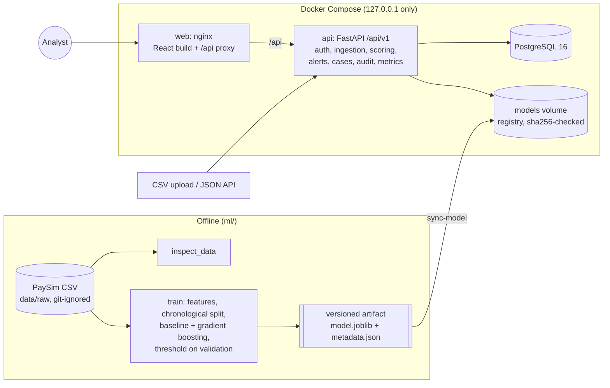

# FinTrace Architecture

FinTrace is three pieces: an offline ML pipeline that trains and versions a model, a FastAPI
service that stores transactions and scores them, and a React dashboard where people review what
was flagged. PostgreSQL holds everything except the model file.



## Request path

1. The browser loads the React app from nginx (`web`), which also forwards `/api/*` to the API, so
   the browser talks to one origin and needs no CORS. nginx adds a content security policy and
   other security headers to every response.
2. The API (`api`) checks the JWT, then the role (`analyst` < `senior_analyst` < `admin`) on the
   server for every protected route.
3. Each request gets a request ID, which is returned in error bodies
   (`{"error": {"code", "message", "details", "request_id"}}`) and response headers.

## Data flow

| Step | Where | What happens |
|---|---|---|
| Import | `services/ingestion.py` | CSV upload (50 MB cap) or JSON batch. Every row validated; bad rows reported with their line number; duplicates skipped by `external_id`. |
| Score | `services/scoring.py` | Builds the same features as training (shared code in `ml/fintrace_ml/features.py`), runs the active model, evaluates the enabled monitoring rules, stores one risk assessment per transaction (model version, time, score, level, reason codes, rule hits). A PostgreSQL advisory lock serialises scoring runs. |
| Alert | `services/alerts.py` | An alert is raised when the score reaches the model's threshold or a high-severity rule fires. One open alert per transaction (partial unique index). Priority is **critical** only when the model and at least two rules agree (ADR-020). |
| Investigate | `services/cases.py` | Analysts group alerts into cases, add append-only notes, and move the case through open, investigating and pending decision. Only a senior analyst closes a case, with a decision and written rationale. |
| Audit | `services/audit.py` | Every sensitive change writes an audit event in the same transaction as the change, so there is no change without its record. |
| Report | `api/v1/metrics.py` | Overview counts, the latest score per transaction for the histogram, and the stored offline evaluation with caveats. |

## Model lifecycle

- `python -m fintrace_ml.train ... --promote` writes `ml/artifacts/<version>/` and copies it to
  `ml/artifacts/current`.
- `python -m app.cli sync-model` registers that artifact: it copies it into the registry, records
  its sha256 in `model_versions`, and activates it. The API refuses an artifact whose hash no
  longer matches.
- With no active model, scoring returns `503 MODEL_NOT_AVAILABLE` with the commands to fix it.
  It never invents a score.
- A test checks that the API's scores equal the training pipeline's on 5,000 transactions, so
  online and offline features cannot drift apart.

## Containers

| Service | Image | Notes |
|---|---|---|
| `db` | `postgres:16-alpine` | Data in the `pgdata` volume. Creates the `fintrace_test` database on first start. |
| `api` | `backend/Dockerfile` (python:3.12-slim) | Runs as uid 10001. Applies migrations, then starts uvicorn. Models live in the `models` volume, not in the image. |
| `web` | `frontend/Dockerfile` (node build, then nginx:1.29-alpine) | Serves the static build, falls back to `index.html` for client routes, proxies `/api`. |

All ports bind to `127.0.0.1`, so nothing is reachable from other machines on the network.

## Code map

```
backend/app/api/v1/     route handlers, one file per resource
backend/app/services/   business rules (ingestion, scoring, rules, alerts, cases, registry, audit)
backend/app/models/     SQLAlchemy tables; backend/alembic/ holds the migrations
ml/fintrace_ml/         features (shared with the API), inspection, training, evaluation
frontend/src/pages/     one component per screen; frontend/src/api/schema.d.ts is generated
```

Design choices and their reasons are recorded in [DECISIONS.md](DECISIONS.md).
