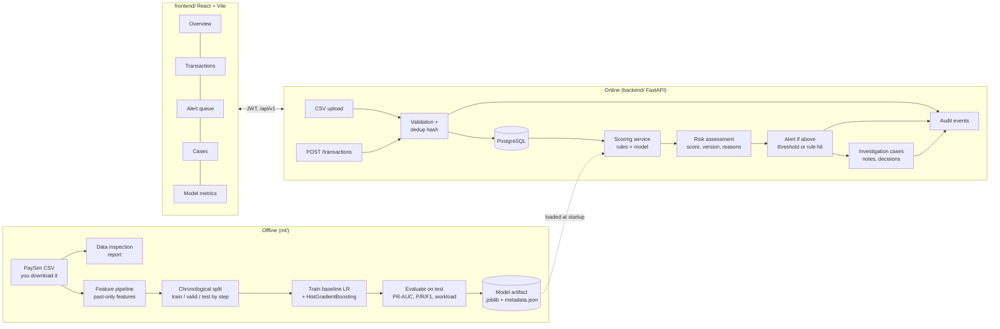
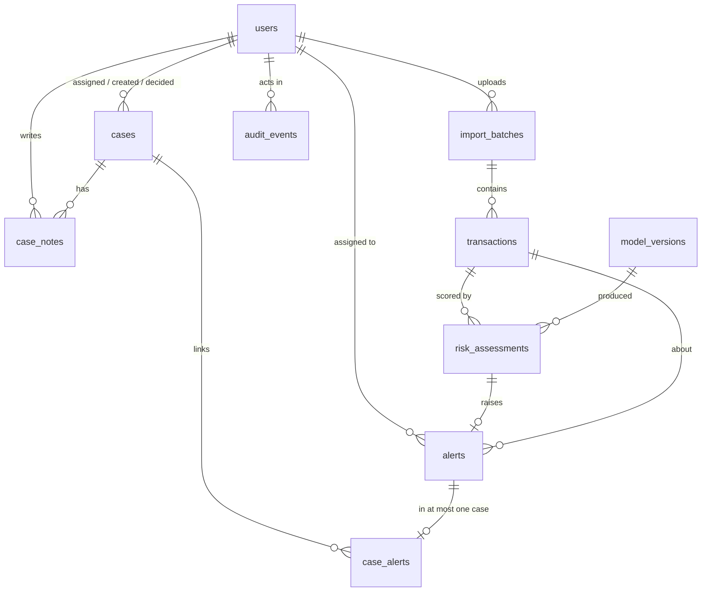

# FinTrace — Implementation Plan

> Intelligent Financial Crime Detection & Investigation Platform.
> Portfolio prototype. Not production-ready, not regulatory-certified, not validated for real AML decisions.
> Risk scores are triage signals for human review, never proof of wrongdoing.

Status: **proposed; Phase 1 in progress** · Last updated: 2026-10-11

---

## 0. Environment inspection (what was actually found)

| Item | Found | Consequence |
|---|---|---|
| Repository | Empty working directory, no git repo, no GitHub repo attached | Fresh repo created locally; push once you name a GitHub repo |
| Python | 3.12.3 (`python3.12`) and 3.13 | Backend and ML pinned to **3.12** via venv |
| Node / npm | Node 22.22, npm 10.9 | Vite + React + TypeScript frontend |
| PostgreSQL | Server and client 16.15 binaries | Tests run against a real PostgreSQL, not SQLite |
| Docker | Engine 29.8 + Compose v5.6 (daemon started manually) | Compose file can be verified here, but Docker Hub returned **429 rate limit** on first pull; retry later |
| Package tools | pip 24, uv, poetry | Plain `venv` + `pip` chosen (most familiar on Windows) |
| Hardware | 4 CPU, 15 GB RAM | Enough to train on full PaySim (6.36M rows) with scikit-learn |
| Your machine | Windows, PowerShell | Every README command shown for PowerShell **and** bash |

---

## 1. System architecture and data flow

**Key boundaries**

- **Training is offline.** `ml/` scripts read a CSV and write an artifact folder. The API never trains.
- **Inference is online.** The API loads the artifact named in `model_versions` (active row). No artifact means scoring returns `503 MODEL_NOT_AVAILABLE` with the exact command to train one. (Planned rules-only scoring was dropped in Phase 4: every assessment names a model version, ADR-018.)
- **One shared feature module** (`ml/fintrace_ml/features.py`) is imported by both training and the API, so online features match offline features.
- **Human in the loop.** The system raises alerts. Only an analyst records a case decision.

---

## 2. Database schema

| Table | Key columns | Constraints and indexes |
|---|---|---|
| `users` | id, email, full_name, password_hash, role (`analyst`, `senior_analyst`, `admin`), is_active, created_at | `email` unique (lower-cased) |
| `import_batches` | id, filename, file_sha256, uploaded_by → users, rows_total, rows_inserted, rows_duplicate, rows_rejected, errors (jsonb, capped), status, created_at | index on created_at |
| `transactions` | id, dedup_key, external_id, source (`csv`, `api`), import_batch_id → import_batches, step, occurred_at, type, amount, origin_account, dest_account, old/new balances (orig & dest), label_is_fraud (nullable, synthetic ground truth only), created_at | `dedup_key` unique (duplicate-safe imports via `ON CONFLICT DO NOTHING`); `amount > 0`; balances `>= 0`; `type` in 5 PaySim types; indexes on occurred_at, origin_account, dest_account, type |
| `monitoring_rules` | id, code, name, description, rule_type, parameters (jsonb), severity, enabled, updated_by, updated_at | `code` unique; parameters validated by Pydantic per rule_type |
| `model_versions` | id, version, algorithm, artifact_path, artifact_sha256, feature_set, threshold, metrics (jsonb), dataset_fingerprint, trained_at, is_active | `version` unique; partial unique index: only one `is_active = true` |
| `risk_assessments` | id, transaction_id → transactions, model_version_id → model_versions (required, ADR-018), risk_score (0–1), risk_level, reason_codes (text[]), rule_hits (jsonb), scored_at | `0 <= risk_score <= 1`; index (transaction_id, scored_at desc) |
| `alerts` | id, transaction_id, risk_assessment_id, priority (`low`…`critical`), status (`open`, `in_review`, `escalated`, `closed_false_positive`, `closed_actioned`), assignee_id → users, created_at, updated_at | `risk_assessment_id` unique; indexes on (status, priority), assignee_id |
| `cases` | id, reference (`CASE-000123`), title, description, status (`open`, `investigating`, `pending_decision`, `closed`), priority, assignee_id, created_by, decision (`no_further_action`, `false_positive`, `escalate_for_reporting`), decision_rationale, decided_by, decided_at, timestamps | `reference` unique; CHECK: status `closed` ⇔ decision not null |
| `case_alerts` | case_id, alert_id, linked_by, linked_at | PK (case_id, alert_id); `alert_id` unique (one case per alert) |
| `case_notes` | id, case_id, author_id, body, created_at | append-only (no update/delete endpoint) |
| `audit_events` | id, actor_id, action, entity_type, entity_id, before (jsonb), after (jsonb), request_id, created_at | index (entity_type, entity_id), created_at; append-only |

All foreign keys are real FKs with `ON DELETE RESTRICT` (financial records are not cascade-deleted). All timestamps are `timestamptz` in UTC. Money is `NUMERIC(18,2)`.

**Duplicate-safe imports.** PaySim has no transaction ID, so `dedup_key = sha256(source_ref or canonical row fields)`. API clients may send `external_id`, which becomes the key (idempotent retries). Re-uploading the same file inserts 0 rows and reports them as duplicates.

---

## 3. API specification (all under `/api/v1`, OpenAPI at `/docs`)

| Method & path | Purpose | Min role |
|---|---|---|
| `GET /health` | Liveness | public |
| `GET /health/ready` | DB reachable, migrations current, model loaded? | public |
| `POST /auth/login` | Email + password → JWT access token | public |
| `GET /auth/me` | Current user | analyst |
| `GET /users`, `POST /users`, `PATCH /users/{id}` | Manage users and roles | admin |
| `GET /users/assignable` | Active users (name, role) for assignment | analyst |
| `POST /transactions` | Ingest 1–1000 transactions (JSON, idempotent) | senior_analyst |
| `GET /transactions` | Search: `q`, `type`, `min_amount`, `max_amount`, `account`, `from`, `to`, `risk_level`, `has_open_alert`, `sort`, `page`, `page_size` | analyst |
| `GET /transactions/{id}` | Detail + assessments + alerts + linked cases | analyst |
| `POST /imports` | Multipart CSV upload → validated, deduplicated batch report | senior_analyst |
| `GET /imports`, `GET /imports/{id}` | Import history and row-level rejects | analyst |
| `POST /scoring/transactions/{id}` | Score one transaction (rules + model) | senior_analyst |
| `POST /scoring/run` | Score all unscored transactions (bounded batch) | senior_analyst |
| `GET /models`, `GET /models/active` | Registered model versions + metrics | analyst |
| `POST /models/{id}/activate` | Switch active model | admin |
| `GET /rules`, `PATCH /rules/{id}` | View / tune monitoring rules | analyst / admin |
| `GET /alerts` | Queue: `status`, `priority`, `assignee_id`, `unassigned`, `min_score`, `reason_code`, `page` | analyst |
| `GET /alerts/{id}` | Alert + transaction + assessment | analyst |
| `PATCH /alerts/{id}` | Change status; assign (assign others: senior_analyst) | analyst |
| `POST /cases`, `GET /cases`, `GET /cases/{id}` | Create / list / view cases | analyst |
| `PATCH /cases/{id}` | Status, priority, assignee | analyst (own) / senior_analyst |
| `POST /cases/{id}/alerts`, `DELETE /cases/{id}/alerts/{alert_id}` | Link / unlink alerts | analyst |
| `POST /cases/{id}/notes` | Add note | analyst |
| `POST /cases/{id}/decision` | Record decision + rationale, closes case | senior_analyst |
| `GET /audit-events` | Filter by entity, actor, date | senior_analyst |
| `GET /metrics/overview` | Counts, alert rates, open workload (computed from DB) | analyst |
| `GET /metrics/risk-distribution` | Histogram of risk scores | analyst |
| `GET /metrics/model-evaluation` | Stored evaluation of the active model | analyst |

**Conventions**

- Pagination: `page` (1-based), `page_size` (default 25, max 200); response `{items, page, page_size, total}`.
- Errors: always `{"error": {"code": "VALIDATION_ERROR", "message": "...", "details": [...], "request_id": "..."}}` with correct HTTP status (400, 401, 403, 404, 409, 422, 503).
- Every request gets an `X-Request-ID`, which is stored on audit events.
- Authorization is enforced by FastAPI dependencies on the server; the frontend only hides buttons for convenience.

---

## 4. Implementation plan (six milestones fitted to your one-week timeline)

The brief asked for a six-week plan, but you have one week. So the plan is **six milestones**, each a coherent, tested phase, spread across seven days. Each phase ends with tests + lint run, a changed-file list, commands run, and a complete / incomplete / blocked summary.

| # | Day | Milestone | Done when |
|---|---|---|---|
| **1** | Day 1 | **Foundation**: repo layout, backend app factory, settings from env, SQLAlchemy models for the full schema, first Alembic migration, consistent error handler, request IDs, health endpoints, users + password hashing + JWT login + role checks, audit helper, pytest against real PostgreSQL, ruff, CI workflow skeleton | `alembic upgrade head` on empty DB works; auth/RBAC/health tests pass; ruff clean |
| **2** | Day 2 | **Ingestion**: CSV schema validation (row-level reject report), duplicate-safe bulk insert, JSON ingestion API, transaction search/detail with pagination, labelled **synthetic sample generator** (PaySim-shaped, clearly marked), import audit events | Same file imported twice → 0 new rows; bad rows reported, not silently dropped |
| **3** | Day 3 | **ML pipeline**: data inspection report (imbalance, missing values, leakage notes), past-only feature engineering, chronological split, baseline logistic regression + HistGradientBoosting, threshold selection on validation only, test-set report, versioned artifact + metadata | Report numbers come from an actual run; rerun with same seed gives same metrics |
| **4** | Day 4 | **Scoring and alerts**: configurable rules engine, model loader, `MODEL_NOT_AVAILABLE` path, risk assessments with reason codes, alert creation and prioritisation, alert queue API with filters/assignment/status transitions | Scoring without artifact returns 503 with fix; with artifact persists version + reasons |
| **5** | Day 5–6 | **Investigations + frontend**: cases, links, notes, decisions, audit API, metrics API; React dashboard (overview, transactions, alert queue, transaction detail, cases, model evaluation, login) with loading / empty / error states | Every visible button calls the backend; synthetic-data labels shown |
| **6** | Day 7 | **Packaging and delivery**: Docker Compose (db, api, web), seed + demo script, Playwright screenshots, README, measured model report, architecture doc + ADRs, known limitations, truthful resume bullets, full CI green | Fresh checkout → README steps → working demo |

**Scope guard.** If the week runs short, the cut order is: AML network analytics (optional, not started unless time remains) → model comparison ablations → extra frontend polish. Tests, migrations, auth, and the investigation workflow are never cut.

---

## 5. Dependency and environment plan

**Backend (`backend/pyproject.toml`, Python 3.12)**

| Package | Why |
|---|---|
| fastapi, uvicorn[standard] | API server |
| pydantic v2, pydantic-settings | Validation, typed config from `.env` |
| sqlalchemy 2.x, psycopg[binary] 3.x, alembic | ORM, PostgreSQL driver, migrations |
| pyjwt | JWT access tokens |
| pwdlib[argon2] | Argon2 password hashing |
| python-multipart | CSV upload |
| pandas, scikit-learn, joblib, numpy | Shared with ML for online feature computation and inference |
| **dev:** pytest, pytest-cov, httpx, ruff | Tests and lint/format |

**ML (`ml/`)**: same Python env plus the `ml` package; no extra heavy dependency.
**XGBoost / SHAP: not added.** scikit-learn's `HistGradientBoostingClassifier` gives comparable gradient-boosting results on tabular data without a native-library install, which matters on Windows. Reason codes come from rule hits plus transparent feature-based explanations (logistic-regression contributions for the baseline). This is revisited only if Phase 3 shows a real gap.

**Frontend (`frontend/`)**: React 18, TypeScript, Vite, React Router, TanStack Query (server state, loading/error handling), Recharts (charts), plain CSS modules with design tokens (no heavy UI kit), Vitest + Testing Library, ESLint. Playwright (already in this environment) for screenshots only.

**Infrastructure**: PostgreSQL 16, Docker Compose (db, api, web), GitHub Actions (backend lint + tests with a Postgres service container, frontend lint + typecheck + tests + build).

**Configuration**: `.env.example` committed with safe placeholders; `.env` ignored. `FINTRACE_JWT_SECRET` has no default in non-test environments; the app refuses to start without it. Data files (`data/raw/`) and model artifacts (`ml/artifacts/`) are git-ignored, except a tiny synthetic sample.

**Getting PaySim (you do this; nothing is auto-downloaded)**: the dataset is "Synthetic Financial Datasets For Fraud Detection" by Edgar Lopez-Rojas on Kaggle (search for *PaySim* on kaggle.com, dataset owner `ealaxi`). Sign in, accept the licence shown on the dataset page (check it yourself; it has been listed as CC BY-SA 4.0), download, and place the CSV at `data/raw/paysim.csv`. The README will give the expected columns and row count so you can check the file.

---

## 6. Risks, assumptions and acceptance tests

**Risks**

| Risk | Impact | Mitigation |
|---|---|---|
| PaySim is simulated; fraud only occurs in `TRANSFER` and `CASH_OUT` | Metrics look better than real-world fraud detection | State this in every report; never call labels "money laundering" |
| Leakage from post-transaction balances (`newbalanceOrig`, `newbalanceDest`) and the `isFlaggedFraud` rule output | Inflated scores | Exclude `isFlaggedFraud` and IDs; default "strict" feature set uses pre-transaction info only; post-balance features shown only as a labelled ablation |
| Extreme imbalance (~0.13% fraud) | Accuracy is meaningless | Report PR-AUC, precision/recall at chosen thresholds, alerts per 1,000 transactions |
| Random splits leak future behaviour | Over-optimistic results | Split by `step` (hour) chronologically; fit preprocessing on train only |
| Docker Hub rate limit seen in this environment | Compose not verifiable immediately | Local PostgreSQL used for tests; retry Compose verification in Phase 6 |
| No remote repository yet | Work lives in this temporary environment | Snapshot code to the project files after each phase; push as soon as you name a repo |
| One-week timeline | Unfinished features | Phase-by-phase scope guard above |
| Windows vs Linux differences | Commands fail on your machine | PowerShell + bash commands in README; no shell-specific scripts on the critical path (Python scripts instead) |

**Assumptions**

1. Single-tenant prototype; three roles are enough.
2. PaySim `step` (hour 1–743) is mapped to a synthetic `occurred_at` starting from a fixed epoch; this is documented.
3. Transactions are imported and then scored in a batch or on demand, not streamed.
4. Seeded demo users are for local use only; their passwords come from your `.env`, not from the repo.

**Acceptance tests (each becomes an automated test or a scripted check)**

| ID | Check |
|---|---|
| AT-01 | `alembic upgrade head` on an empty DB succeeds; `downgrade base` succeeds |
| AT-02 | `/health` returns 200; `/health/ready` reports DB and model status truthfully |
| AT-03 | Wrong password → 401; analyst calling an admin endpoint → 403 (server-side) |
| AT-04 | Passwords stored as Argon2 hashes, never returned by the API |
| AT-05 | Valid CSV import inserts N rows; same file again inserts 0 and reports N duplicates |
| AT-06 | CSV with bad rows: good rows inserted, bad rows reported with row number and reason |
| AT-07 | Transaction search filters and pagination return correct totals |
| AT-08 | Scoring with no model artifact → 503 `MODEL_NOT_AVAILABLE` with instructions |
| AT-09 | Scoring with an artifact persists score, model version, timestamp, reason codes |
| AT-10 | Rule thresholds edited by admin change alert outcomes; edit is audited |
| AT-11 | Alerts filter by status/priority/assignee; invalid status transitions rejected (409) |
| AT-12 | Case: create, link alert, add note, decide; closing without decision rejected |
| AT-13 | Every sensitive change (role change, rule edit, alert status, assignment, decision, model activation) writes an audit event |
| AT-14 | Training pipeline: chronological split verified (max train step < min test step); preprocessing fit on train only; same seed → same metrics |
| AT-15 | Evaluation report contains precision, recall, F1, PR-AUC, confusion matrix, alerts per 1,000 and threshold table, all from an actual run |
| AT-16 | Frontend builds, type-checks, and every page renders loading, empty and error states |
| AT-17 | Fresh checkout following the README reaches a working demo (Phase 6 scripted run) |
